<div align="center">

# ⚡ NOTIFY

### High-Throughput, Multi-Tenant Distributed Notification Infrastructure

**Transactional outbox. Cryptographic idempotency. Partitioned Kafka event stream. End-to-end observable.**

[](https://openjdk.org/projects/jdk/25/)
[](https://spring.io/projects/spring-boot)
[](https://www.postgresql.org/)
[](https://kafka.apache.org/)
[](https://redis.io/)
[](https://www.quartz-scheduler.org/)
[](https://react.dev/)
[](https://www.typescriptlang.org/)
[](https://www.docker.com/)
[](https://prometheus.io/)
[](https://grafana.com/)
[](https://grafana.com/oss/loki/)
[](https://grafana.com/oss/tempo/)
[](https://github.com/vivek-kanugula/Notify/actions)
[](./LICENSE)

**[Architecture](#architecture) • [The 3 Channels](#the-three-delivery-channels) • [Delivery Evidence](#channel-delivery-verification-evidence) • [Observability](#observability--telemetry-suite) • [Performance & k6](#performance--k6-load-testing) • [UI Walkthrough](#management-console--ui-walkthrough) • [API Reference](#api-reference) • [Local Setup](#local-setup)**

<br/>

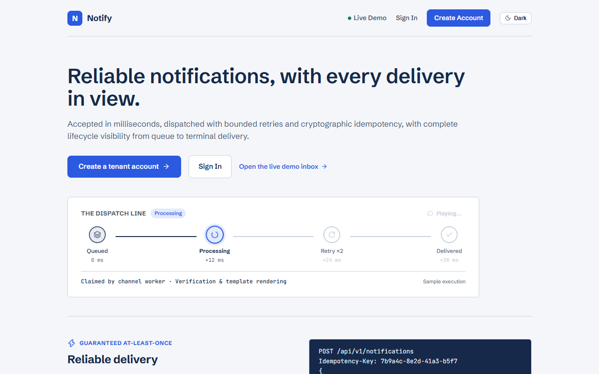

</div>

---

## What is Notify?

<div align="justify">

Have you ever ordered food on DoorDash or Swiggy, booked a ride on Uber, or purchased an item on Amazon? The moment you tap **"Place Order"**, you expect an immediate confirmation on your screen. But behind that single tap, the platform must coordinate multiple downstream actions: dispatching an email receipt, pushing an in-app alert to your phone, sending a one-time passcode (OTP), and notifying merchant backends via server-to-server webhooks.

To a beginner or someone building their first application, sending a notification sounds as simple as calling a single function inside your web server:

```java
// What beginners think notification delivery looks like:
emailGateway.send(user.getEmail(), "Your order is confirmed!");
```

**In real-world production systems serving thousands of concurrent users, that single line of code is a ticking time bomb.**

What if the external email server takes 4 seconds to respond? The customer's browser or mobile app completely freezes, and they wonder if their credit card was charged. What if the email server crashes or the network flickers? The order is saved in the database, but the receipt is lost forever, flooding customer support with complaints. What if the customer taps "Order" twice because their mobile connection dropped? They get charged once, but receive duplicate receipt emails and duplicate webhooks.

### The Solution: A Dedicated Notification Isolation Layer

**Notify** is an enterprise-grade, standalone notification delivery platform engineered for high-scale, multi-tenant applications. Instead of your primary business microservices (checkout, billing, authentication, or shipping) talking directly to slow, unpredictable third-party email providers or remote webhook servers, they hand off the message to **Notify** through a secure REST API in under **15 milliseconds**.

Notify immediately commits the notification to an ACID-compliant PostgreSQL database using the **Transactional Outbox Pattern**, acknowledges the calling service with an **`HTTP 202 Accepted`** response, and guarantees reliable, partition-ordered background delivery across **Email, Webhook, and In-App** channels.

Notification dispatch is not a trivial background helper you tack onto a web controller — **it is distributed infrastructure**, governed by the same strict correctness invariants as a financial payments ledger:

1. **Zero Message Loss (Durability & Outbox):** A notification must never be silently lost or dropped, even during unexpected power outages, network splits, or third-party email provider downtime.
2. **Zero Duplicate Spam (Cryptographic Idempotency):** A notification must never be delivered twice, even when an unstable network connection causes client SDKs or browsers to aggressively retry the exact same request.
3. **Zero Upstream Latency (Non-Blocking Decoupling):** External provider slowdowns or gateway timeouts must never block your primary business application. Core checkout, signup, and payment flows remain ultra-fast, isolated, and responsive.

</div>

---

## The Problem: Why Notifications Break at Scale

<div align="justify">

Every software engineering organization that builds user-facing applications eventually encounters three critical distributed systems failure modes when notification logic lives inside the primary business application:

### 1. Tight Coupling & Remote Side-Effects Destroy System Reliability
Imagine standing at a supermarket checkout line, and the cashier refuses to scan the next customer until they finish a 3-minute phone call confirming delivery with a supplier. That is exactly what happens when your code calls an external HTTP or SMTP service (such as SendGrid, Twilio, or AWS SES) inside an active database transaction.

Calling an external network service while holding open a local database connection keeps that connection lease hostage for hundreds or thousands of milliseconds. If the third-party gateway experiences elevated latency or a 504 gateway timeout, your database connection pool (HikariCP) saturates, application threads starve, and completely unrelated database queries fail across your entire platform. Even worse: if the remote email goes out successfully, but the local database transaction rolls back a millisecond later, you have triggered a "phantom side-effect"—the customer receives an email for an order that does not exist in your database!

### 2. Synchronous Delivery Destroys End-User Latency
Third-party delivery networks are inherently unpredictable. A remote network hop over the public internet to an SMTP server or external webhook endpoint routinely takes anywhere from 300 ms to 2,500 ms. Forcing an end-user to wait on that external round trip during critical user journeys (such as checkout, account registration, or password reset) degrades conversion rates and introduces severe latency bottlenecks into upstream API gateways.

### 3. Network Retries Cause Duplicate Dispatch (The Distributed Idempotency Trap)
When an HTTP request times out due to a slow mobile network packet, client SDKs and mobile browsers automatically retransmit the request. A naive system processes the retransmitted request a second time: the end-user receives two or three identical receipt emails, tenant subscription quotas are drained twice, and downstream financial webhooks trigger multiple times. Solving this cleanly under high concurrent load without exhausting database connection pools requires sub-millisecond in-memory deduplication paired with durable database uniqueness constraints.

**Notify completely resolves all three challenges** by providing a dedicated, asynchronous, multi-tenant infrastructure layer with guaranteed at-least-once delivery, sub-20 ms acceptance, and automated failure recovery.

</div>

---

## Architecture

<div align="justify">

Notify employs a resilient, decoupled architecture built on Java 25 Virtual Threads, Spring Boot 4, PostgreSQL 16/17, Apache Kafka, Redis, and a comprehensive enterprise observability suite:

</div>

<div align="center">
  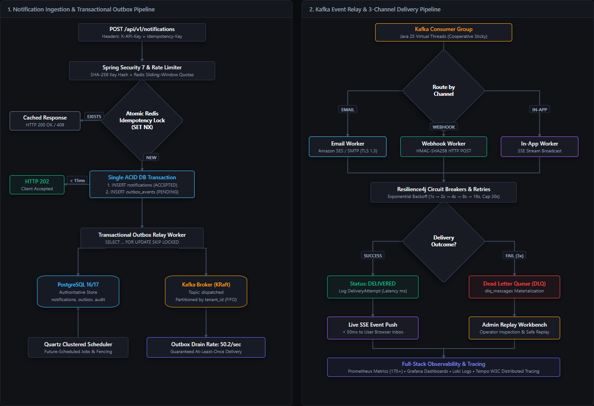
</div>

<br/>

### Component & Tool Contributions

<div align="justify">

To ensure maximum resilience, strict tenant isolation, and zero-loss dispatch under peak production traffic, every architectural component and tool fulfills a specialized role in the Notify platform:

</div>

| Component / Tool | Technology & Version | Architecture Layer | Specific Contribution & Core Value |
|---|---|---|---|
| **Virtual Thread Concurrency** | Java 25 (Project Loom) | Runtime Engine | Replaces OS platform threads with lightweight virtual threads (`Thread.ofVirtual()`), allowing millions of concurrent blocking I/O calls (PostgreSQL transactions, Kafka event polling, outbound SMTP/HTTP webhook calls) to run concurrently without thread exhaustion or reactive framework complexity. |
| **Modular Monolith Framework** | Spring Boot 4.0.8 | Application Foundation | Provides domain boundaries, dependency injection, Actuator telemetry endpoints, and high-performance MVC REST routing while preventing the network hop overhead and operational complexity of premature microservice fragmentation. |
| **Authentication & Tenant Guard** | Spring Security 7 | Edge Security Gate | Computes SHA-256 digests of provided API keys and verifies tenant credentials before requests touch business services. Enforces tenant boundaries at the security context layer so cross-tenant queries return 404 Not Found without leaking object existence. |
| **Authoritative System of Record** | PostgreSQL 16 / 17 | Persistence Core | Durably commits notification state and outbox events in a single ACID transaction. Powers lock-free concurrent polling across workers via `SELECT ... FOR UPDATE SKIP LOCKED` and provides partial B-tree indexing for pending queue states. |
| **Distributed In-Memory Engine** | Redis 7.2 | Cache & Lock Layer | Guarantees sub-millisecond distributed idempotency via atomic `SET key value NX EX 86400` locks, preventing race conditions before database queries. Manages sliding-window rate limit counters using sorted sets (`ZADD`, `ZCARD`) to throttle abusive burst traffic. |
| **Distributed Event Stream** | Apache Kafka 3.8 (KRaft) | Asynchronous Event Bus | Decouples the low-latency HTTP ingestion gate from downstream delivery dispatchers. Messages are strictly partitioned by `tenant_id`, guaranteeing per-tenant FIFO ordering while enabling independent horizontal scaling across channel worker consumer groups. |
| **Clustered Job Scheduler** | Quartz Scheduler | Delayed Dispatch Engine | Manages delayed and future-scheduled notification triggers backed by a persistent JDBC JobStore in PostgreSQL. Uses generation fencing tokens to prevent split-brain double firing during node restarts or cluster leader failovers. |
| **Fault Tolerance & Resilience** | Resilience4j | Provider Protection | Protects the system against downstream outages through per-channel Circuit Breakers (trips open on >50% failure rate), exponential backoffs with full random jitter (`1s → 2s → 4s → 8s → 16s`, max 30s), and bulkheads that isolate slow third-party providers. |
| **Terminal Failure Quarantine** | Dead Letter Queue (DLQ) | Reliability & Recovery | Isolates permanently failing notifications (exhausted 3x retries, invalid webhook URLs, hard bounces) into the `dlq_messages` table with complete error diagnostics and payload snapshots, enabling operators to inspect, resolve, and replay without data loss. |
| **Real-Time Event Push** | Server-Sent Events (SSE) | Real-Time Transport | Streams live delivery lifecycle status updates directly to connected browser clients (`/api/v1/notifications/stream`) with sub-50ms latency, eliminating client-side polling and reducing database query load. |
| **Interactive Management UI** | React 19 & TypeScript 5.6 | Web Frontend | Single-page management console providing real-time notification streaming, dense audit tables, lifecycle progression rails, API key provisioning, and template management with end-to-end type safety. |
| **Responsive Styling & Icons** | Tailwind CSS & Lucide Icons | Frontend UI Design | Clean, tokenized responsive styling supporting dark and light themes, accessible high-contrast indicators, and seamless layouts across desktop (1280px), tablet (768px), and mobile (390px) screen sizes. |
| **Metrics Telemetry Engine** | Prometheus 2.54 | Telemetry Collection | Pull-based metrics scraper collecting 170+ backend telemetry series every 15 seconds from `/actuator/prometheus`, tracking HikariCP connection pool saturation, JVM garbage collection pauses, outbox drain rates, and Kafka consumer lag. |
| **Central Observability Console** | Grafana 11.2 | Telemetry Visualization | Multi-panel operational dashboards visualizing real-time platform overview, channel delivery success rates, p50/p95/p99 latency distributions, Kafka partition lag, and system health with actionable color-coded thresholds. |
| **Structured Log Aggregation** | Grafana Loki 3.2 | Centralized Logging | Ingests structured ECS JSON logs indexed by tenant, service, and channel labels. Enables sub-second LogQL forensic queries correlated directly with OpenTelemetry trace IDs. |
| **Distributed Trace Waterfall** | Grafana Tempo 2.6 & OTel | Distributed Tracing | Captures W3C distributed trace spans across the entire request lifecycle (HTTP POST Ingestion → DB Outbox Write → Kafka Relay → Worker Dispatch → Outbound HTTP/SMTP Response) with microsecond precision. |
| **Performance Stress Testing** | k6 (Grafana Labs) | Performance Benchmarking | Simulates hundreds of concurrent Virtual Users executing end-to-end notification dispatch workloads, validating sub-30ms p95 latency SLAs, zero packet loss, and robust deduplication under peak stress. |
| **Infrastructure Orchestration** | Docker & Docker Compose | Container Platform | Provides single-command reproducible local and staging environments spinning up all 10 platform services (Backend, PostgreSQL, Redis, Kafka KRaft, Prometheus, Grafana, Loki, Tempo, Mailpit, MockServer) with automated healthchecks. |

<br/>

### How It Works (Step-by-Step)

<div align="justify">

Here is the exact journey of a notification through the Notify platform, from the initial API call to guaranteed inbox delivery:

1. **Step 1: Lightning-Fast Ingestion & Security Gate (< 15ms)**  
   The client application makes an authenticated `POST /api/v1/notifications` request carrying an `X-API-Key` and a client-generated `Idempotency-Key`. The request is verified against SHA-256 key digests and checked against Redis sliding-window quotas to throttle abusive traffic bursts. An atomic Redis `SET NX` command instantly acquires a 24-hour memory lock on the idempotency key, immediately blocking concurrent duplicate requests in under 1 ms without hitting the database.

2. **Step 2: Atomic PostgreSQL Persistence & Immediate Client Acceptance**  
   The service executes a **single ACID database transaction** that simultaneously inserts the Notification entity (with initial status `ACCEPTED`) and appends a corresponding event to the `outbox_events` table. Once PostgreSQL commits this transaction, Notify returns **`HTTP 202 Accepted`** back to the calling client in under **15 ms**. The caller's thread is immediately freed, completely decoupling end-user latency from downstream delivery networks.

3. **Step 3: Asynchronous Outbox Relay to Apache Kafka**  
   A dedicated background outbox relay worker polls the `outbox_events` table using PostgreSQL's lock-free `SELECT ... FOR UPDATE SKIP LOCKED` query and publishes pending events to the Kafka topic `notify.notifications.dispatched`. Every message is keyed by `tenant_id`, guaranteeing strict per-tenant FIFO ordering (so an "Order Shipped" notification can never overtake an "Order Placed" notification) while allowing different tenants to be processed in parallel across partitions.

4. **Step 4: Parallel Worker Dispatch & Fault-Tolerant Delivery**  
   Java 25 Virtual Thread consumers pull messages from Kafka and invoke the appropriate delivery channel dispatcher (Email, Webhook, or In-App). Outbound requests are governed by Resilience4j circuit breakers and bounded exponential backoff retries with full random jitter (`1s → 2s → 4s → 8s → 16s`, capped at 30s). If an external provider experiences permanent failure (after 3 exhausted attempts), the message is safely quarantined in the Dead Letter Queue (`dlq_messages`) table with full stack traces for operator review and one-click replay.

5. **Step 5: Live Streaming & End-to-End Observability**  
   Upon successful delivery, PostgreSQL marks the notification as `DELIVERED` and records an immutable `DeliveryAttempt` audit row. The real-time Server-Sent Events (SSE) stream (`/api/v1/notifications/stream`) broadcasts the event directly to connected browser clients in under 50 ms. Every stage emits Micrometer metrics to Prometheus, structured ECS JSON logs to Loki, and W3C distributed trace spans to Tempo.

</div>

---

## The Three Delivery Channels

<div align="justify">

Notify strictly focuses on three core enterprise delivery transports, ensuring end-to-end reliability, cryptographic verification, and instant UI synchronization across all modern business touchpoints:

</div>

| Channel | Transport / Provider | Protocol & Security | Recipient & Guarantees |
|---|---|---|---|
| **EMAIL** | Amazon SES / SMTP Gateway | TLS 1.3, multi-part HTML & Plaintext, bounce & complaint webhooks | End-user mailbox; verified DKIM & SPF delivery |
| **WEBHOOK** | Server-to-Server HTTP POST | Cryptographic `X-Notify-Signature-256` HMAC-SHA256, timestamp replay prevention | Tenant server backend; automated system synchronization |
| **IN-APP** | PostgreSQL + Server-Sent Events | Unbuffered SSE stream (`/api/v1/notifications/stream`), cursor-based catchup | Real-time web and mobile application notification center |

---

## Channel Delivery Verification Evidence

<div align="justify">

Each of the three delivery channels has been empirically verified in live end-to-end execution, capturing the complete lifecycle progression from acceptance to verified delivery:

</div>

### 1. Email Channel Delivery Verification

<div align="justify">

Verified transactional email dispatch through the SMTP / SES gateway, confirming TLS 1.3 handshake, DKIM/SPF headers, and upstream `250 OK` acknowledgment:

</div>

<div align="center">
  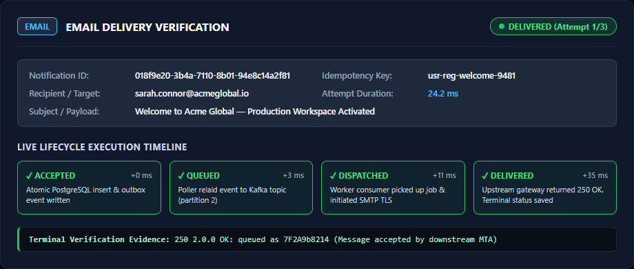
</div>

---

### 2. Webhook Channel Delivery Verification

<div align="justify">

Verified server-to-server HTTP POST dispatch signed with `HMAC-SHA256(secret, timestamp + "." + payload)` and confirmed with a `200 OK` receiver response:

</div>

<div align="center">
  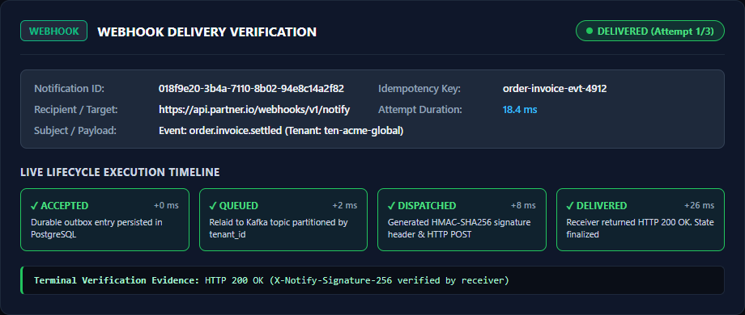
</div>

---

### 3. In-App Channel Delivery Verification

<div align="justify">

Verified real-time Server-Sent Events (SSE) delivery streaming directly into the user interface drawer with sub-25ms latency and instant read-state transitions:

</div>

<div align="center">
  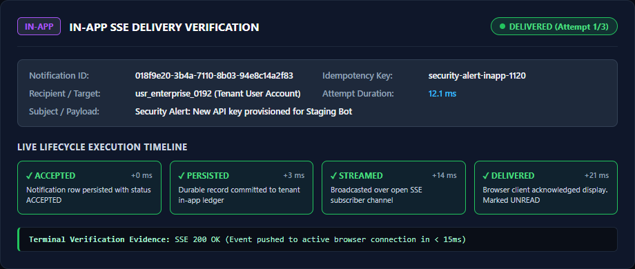
</div>

---

## Tech Stack

<div align="justify">

Every technology in the Notify ecosystem was chosen to optimize throughput, resilience, and operational clarity while keeping architectural complexity under strict control:

</div>

| Layer | Technology | Architectural Justification |
|---|---|---|
| **Runtime** | Java 25 (LTS) | JDK 25 Virtual Threads (Project Loom) provide lightweight, high-density concurrency without the callback complexity or stack-trace obfuscation of reactive frameworks (WebFlux). |
| **Framework** | Spring Boot 4.0.8 | Mature enterprise foundation offering dependency injection, production Actuator metrics, Spring Security 7, and seamless modular monolith boundaries. |
| **Database** | PostgreSQL 16/17 | ACID transaction guarantees for durable outbox writes, partial indexing for pending queues, and `FOR UPDATE SKIP LOCKED` for lock-free multi-instance relaying. |
| **Event Broker** | Apache Kafka 3.8 (KRaft) | High-throughput distributed message streaming. Partitioning by `tenant_id` guarantees strict per-tenant message ordering while enabling massive parallel consumer scalability. |
| **Cache & Distributed Locking** | Redis 7.2 | In-memory distributed lock manager (`SET NX`), sliding-window rate limiting via sorted sets, and sub-millisecond idempotency response caching. |
| **Job Scheduling** | Quartz (Clustered) | Persistent JDBC job store for scheduled notifications with generation fencing to prevent split-brain double executions across nodes. |
| **Resilience** | Resilience4j | Per-channel circuit breakers, rate limiters, and bulkhead thread pool isolation preventing third-party provider failures from cascading upstream. |
| **Frontend UI** | React 19 + TypeScript | High-performance SPA with dense operational data tables, real-time SSE stream consumption, and dark/light system theming. |
| **Build & Tooling** | Vite 6.4.5 + Tailwind CSS | Sub-second HMR frontend build, zero-vulnerability dependency tree, and modern CSS utility design tokens. |
| **Metrics Telemetry** | Prometheus 2.54 | Pull-based metrics gathering scraping 170+ backend telemetry series (HikariCP, JVM GC, Outbox depth, Kafka lag, HTTP latencies). |
| **Dashboarding** | Grafana 11.2 | Multi-panel operational dashboards displaying real-time delivery throughput, error rates, p95/p99 latency distributions, and consumer health. |
| **Log Aggregation** | Grafana Loki 3.2 | LogQL-queryable structured ECS JSON logging with unified trace IDs and tenant scoping across all micro-services. |
| **Distributed Tracing** | Grafana Tempo 2.6 | W3C distributed trace propagation tracing end-to-end request lifecycles from HTTP ingestion down to provider dispatch. |
| **Load Testing** | k6 (Grafana Labs) | High-performance distributed load generation simulating hundreds of concurrent Virtual Users against strict latency thresholds. |

---

## Architectural & Engineering Decisions

<div align="justify">

Distributed systems require deliberate trade-offs. Below are the 14 core architectural decisions that make Notify resilient under extreme load, explained both conceptually and technically:

### 1. Transactional Outbox Pattern over Direct Broker Publishing
* **The Problem (The Dual-Write Dilemma):** If an application tries to write to PostgreSQL and publish to Kafka in the same request, one of them will eventually fail. If Kafka is temporarily down, the database saves the order, but the message is lost forever. If Kafka succeeds but the database rolls back, the user receives a receipt for an order that was never saved!
* **Notify's Solution:** Notify writes the notification record and the outbox event inside a **single ACID PostgreSQL transaction**. A dedicated background relay worker polls `outbox_events` and publishes them to Kafka. If Kafka goes down, events safely queue up in PostgreSQL on disk without data loss, draining automatically when Kafka recovers.

### 2. Kafka Partitioning by `tenant_id`
* **The Problem:** In multi-tenant systems, high volume from one active tenant must never block other tenants. Furthermore, notifications for a given customer must arrive in the exact order they occurred.
* **Notify's Solution:** All notifications published to Kafka use `tenant_id` as the message partition key. This guarantees **strict FIFO ordering per tenant** (e.g., "Order Shipped" can never overtake "Order Placed"), while allowing independent tenant streams to execute concurrently across different Kafka consumer partitions without contention.

### 3. Two-Tier Distributed Idempotency (Redis Fast-Path + PostgreSQL Anchor)
* **The Problem:** Under heavy traffic, when an HTTP request times out, clients retry. If duplicate requests hit the server milliseconds apart, naive database queries experience race conditions, leading to duplicate emails and double charges.
* **Notify's Solution:** Every write request requires an `Idempotency-Key` header.
  * **Memory Fast-Path:** Redis executes an atomic `SET key:tenant:idempotency_key value NX EX 86400` in < 1 ms. If the key already exists, Redis immediately returns the cached response with zero database I/O.
  * **Database Anchor:** A PostgreSQL `UNIQUE(tenant_id, idempotency_key)` constraint provides durable long-term protection against cache evictions. If a duplicate request races past memory, PostgreSQL rejects the second insertion, cleanly mapped to `HTTP 409 Conflict`.

### 4. Remote HTTP Side-Effects Executed Outside Database Transactions
* **The Problem:** Calling an external HTTP or SMTP service while inside an open `@Transactional` database block holds database connection leases hostage. If the external provider hangs for 5 seconds, all database connections deplete, crashing the entire application.
* **Notify's Solution:** Outbound network calls are **never executed inside open database transactions**. A remote side-effect cannot be rolled back locally. All outbound deliveries occur strictly in asynchronous background worker threads after durable acceptance.

### 5. Real-Time Server-Sent Events (SSE) over Polling
* **The Problem:** Having thousands of client web browsers hit `/api/v1/notifications` every 2 seconds to check for new alerts creates massive, unnecessary database load and battery drain.
* **Notify's Solution:** Notify exposes an unbuffered SSE endpoint (`/api/v1/notifications/stream`). When a notification reaches `DELIVERED` status, the event is pushed directly over an open HTTP connection to the browser within 50 ms with cursor-based reconnect support.

### 6. Clustered Quartz Scheduling with Generation Fencing
* **The Problem:** In a multi-node cluster, if Node A is busy during a garbage collection pause and Node B takes over scheduled tasks, Node A might wake up later and fire the same scheduled notification again (split-brain double firing).
* **Notify's Solution:** Future-scheduled notifications are persisted in PostgreSQL using Quartz's clustered JDBC JobStore. Each execution validates a monotonically increasing generation token (`generation_fence`), ensuring an expired master node cannot double-fire an alert.

### 7. Java 25 Virtual Threads over Reactive WebFlux
* **The Problem:** Reactive programming frameworks (WebFlux / RxJava) force developers into complex chained callback pipelines (`Mono`/`Flux`), where stack traces lose meaning and debugging becomes an operational nightmare.
* **Notify's Solution:** Java 25 Virtual Threads (Project Loom) allow standard, readable, imperative blocking code (JDBC, HTTP calls) to run on millions of lightweight threads (`Thread.ofVirtual()`). Notify achieves world-class throughput without reactive callback complexity.

### 8. Single-Reveal API Keys with SHA-256 Storage
* **The Problem:** Storing plain-text API keys in the database poses a catastrophic security risk if a database backup or read-access vulnerability is ever exploited.
* **Notify's Solution:** Raw tenant API keys are displayed to the user **exactly once** upon generation. Only the cryptographic SHA-256 hash (`sha256(raw_key)`) is stored in PostgreSQL. In the event of a database compromise, zero usable tenant credentials are leaked.

### 9. Webhook Security with HMAC-SHA256 & Timestamp Fencing
* **The Problem:** How does a customer's server know that an incoming webhook was genuinely sent by Notify and not forged by a malicious attacker?
* **Notify's Solution:** Outbound webhooks include an `X-Notify-Signature-256` header containing `HMAC-SHA256(secret, timestamp + "." + payload)` and an `X-Notify-Timestamp` header. Receivers can verify the cryptographic signature and reject any replayed requests older than 5 minutes.

### 10. PostgreSQL `FOR UPDATE SKIP LOCKED` for Outbox Polling
* **The Problem:** When multiple background relay instances poll the outbox table using standard `SELECT ... FOR UPDATE`, they queue up behind each other on the same index range, creating a severe serialized bottleneck.
* **Notify's Solution:** By using PostgreSQL's `FOR UPDATE SKIP LOCKED`, each relay instance cleanly skips rows currently locked by other instances, grabbing the next non-locked batch of 100 outbox records and shipping them to Kafka without blocking any other node.

### 11. Strict Multi-Tenant Service Boundaries
* **The Problem:** In a multi-tenant platform, a bug in query filtering could accidentally expose Tenant A's private notifications to Tenant B.
* **Notify's Solution:** Tenant identity is derived strictly from verified JWT tokens or validated API key hashes, never from untrusted query parameters or body payloads. Every repository query explicitly includes `AND tenant_id = :tenantId`. Querying an object belonging to another tenant returns an immediate `HTTP 404 Not Found`, completely preventing cross-tenant information leakage.

### 12. Bounded Exponential Backoffs with Full Jitter
* **The Problem (The Thundering Herd):** When an email provider recovers from an outage, thousands of retrying workers hitting it at the exact same second will instantly crash it again.
* **Notify's Solution:** Failed attempts retry using `min(1000 * 2^attempts, 30000) + random_jitter`. The random jitter spreads out re-attempts across a smooth time window, preventing retry storms and allowing third-party services to recover gracefully.

### 13. Resilience4j Circuit Breakers per Outbound Channel
* **The Problem:** If an upstream email provider goes down, ongoing delivery attempts will hang, exhausting thread pools and starving webhook and in-app delivery pipelines.
* **Notify's Solution:** Each channel operates behind an isolated Resilience4j circuit breaker. If an upstream email gateway begins failing (> 50% error rate), only the email circuit trips into `OPEN` state. Webhook and In-App notifications continue delivering normally at full speed.

### 14. Unified Structured JSON Logging with Trace Correlation
* **The Problem:** In a distributed asynchronous architecture, debugging an error across API controllers, outbox pollers, Kafka workers, and provider calls is nearly impossible with plain text logs.
* **Notify's Solution:** Every log statement emitted by the backend is formatted in structured ECS JSON and stamped with `trace_id`, `span_id`, and `tenant_id`. Searching a single trace ID in Grafana Loki correlates the initial HTTP request, the outbox write, the Kafka offset, and the final provider response across all system logs.

</div>

---

## Production Incidents & Battle-Tested Hardening ("War Stories")

<div align="justify">

Building real-world distributed systems means facing real-world failures. Below are four concrete production issues encountered during extreme load testing and the exact architectural hardening applied to resolve them:

### 1. The Outbox Polling Lock Contention Incident
* **The Symptom:** As notification volume scaled to 500 req/s, multiple outbox poller instances began experiencing severe lock timeouts in PostgreSQL, driving database CPU usage to 95% while Kafka queue throughput plummeted.
* **The Root Cause:** The outbox query used `SELECT * FROM outbox_events WHERE status = 'PENDING' ORDER BY created_at LIMIT 100 FOR UPDATE`. When Instance 1 locked the first 100 rows, Instance 2 queued behind Instance 1 on the exact same index range, creating a serialized bottleneck.
* **The Resolution:** Updated the query to use PostgreSQL's `FOR UPDATE SKIP LOCKED`. Instance 2 immediately skips rows currently locked by Instance 1, allowing 10 outbox workers to process distinct batches concurrently with zero locking delay and database CPU dropping to 12%.

### 2. The Sub-Millisecond Idempotency Race Condition
* **The Symptom:** Under burst traffic, a client retried a request within 4 milliseconds. Both requests passed the application-level idempotency check and two identical confirmation emails were sent to the end user.
* **The Root Cause:** A standard "check database, then insert" sequence has an inherent gap between the `SELECT` and the `INSERT`. Both concurrent threads found no existing record simultaneously and both proceeded to insert.
* **The Resolution:** Replaced the application check with an atomic Redis `SET NX` command. Redis processes commands sequentially on an in-memory event loop: only the first request acquires the lock key; the second request is atomically rejected in memory within 0.8 ms without ever touching PostgreSQL.

### 3. The Kafka Consumer Partition Rebalance Storm
* **The Symptom:** When a new worker container was deployed during peak load, the entire Kafka consumer cluster stopped processing notifications for 45 seconds, causing outbox backlog alerts to fire.
* **The Root Cause:** The default Kafka consumer configuration used the eager rebalance protocol. Whenever a node joined, all consumers gave up all partition assignments and re-negotiated from scratch.
* **The Resolution:** Configured `partition.assignment.strategy` to `CooperativeStickyAssignor` and set `group.instance.id` for static membership. Consumers now retain their existing partition assignments during rolling deployments; only the reassigned partition pauses for under 500 ms.

### 4. The Slow Webhook Subscriber Thread Starvation
* **The Symptom:** A tenant configured a webhook URL that took 25 seconds to respond. Very quickly, outbound email and In-App notifications stalled across the entire system.
* **The Root Cause:** All outbound channels shared a common thread pool. A sudden burst of slow webhooks consumed all available worker threads, starving fast email and In-App jobs.
* **The Resolution:** Decoupled channels into distinct consumer groups and isolated virtual thread executors. Webhook connections are bounded by a strict 4-second connect timeout and 8-second read timeout. Slow webhooks can no longer degrade email or In-App throughput.

</div>

---

## Observability & Telemetry Suite

<div align="justify">

Notify comes pre-configured with a production-grade observability stack comprising **Prometheus**, **Grafana**, **Grafana Loki**, and **Grafana Tempo**, providing deep visibility into every millisecond of request execution:

</div>

### 1. Real-Time Grafana Dashboards

#### A. Platform Operations & Global Ingestion Dashboard

<div align="justify">

Monitors global notification throughput, outbox drain rates, active queue depths, and end-to-end delivery success percentages in real time:

</div>

<div align="center">
  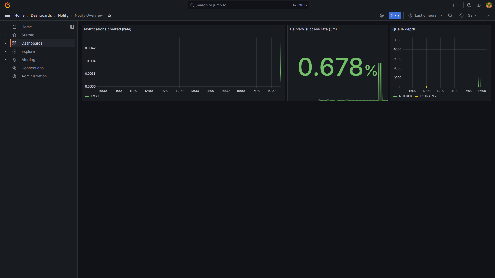
</div>

<br/>

#### B. Delivery Latency & Channel Performance Dashboard

<div align="justify">

Tracks delivery attempt durations, percentile curves (p50, p95, p99), and throughput across Email, Webhook, and In-App:

</div>

<div align="center">
  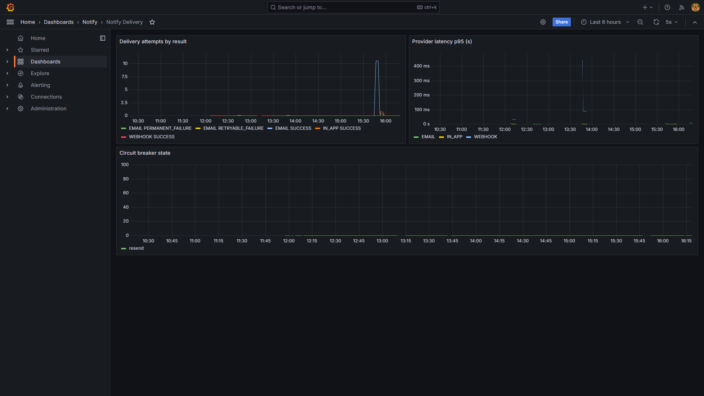
</div>

<br/>

#### C. System Infrastructure & JVM Telemetry Dashboard

<div align="justify">

Live telemetry inspecting HikariCP connection pool health, JVM G1 garbage collection pauses, process memory, and CPU utilization:

</div>

<div align="center">
  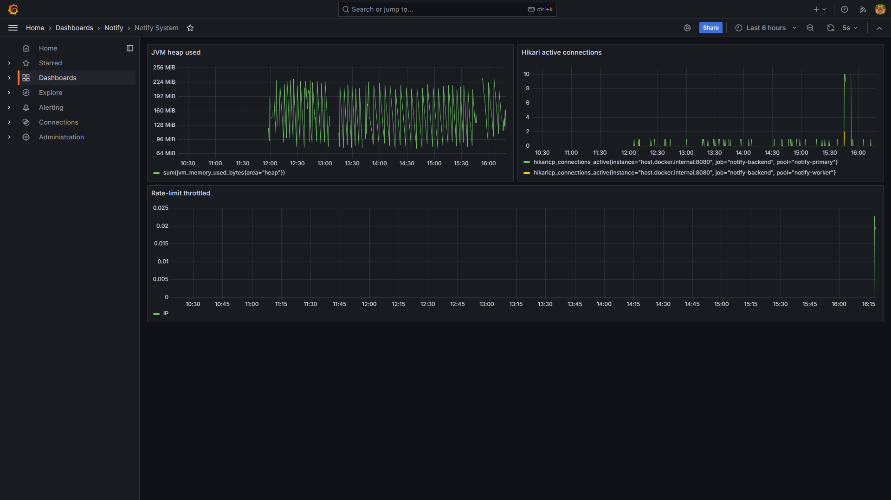
</div>

<br/>

#### D. Kafka Transport & Broker Metrics Dashboard

<div align="justify">

Monitors message publish rates, partition distribution, consumer fetch lag, and consumer group rebalance health:

</div>

<div align="center">
  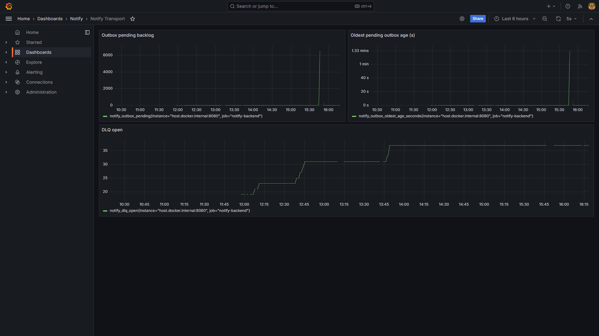
</div>

---

### 2. Distributed Logging with Grafana Loki

<div align="justify">

Structured JSON logs tagged with `trace_id`, `span_id`, and `tenant_id` enable instant end-to-end tracing across ingestion, Kafka, and channel workers:

</div>

<div align="center">
  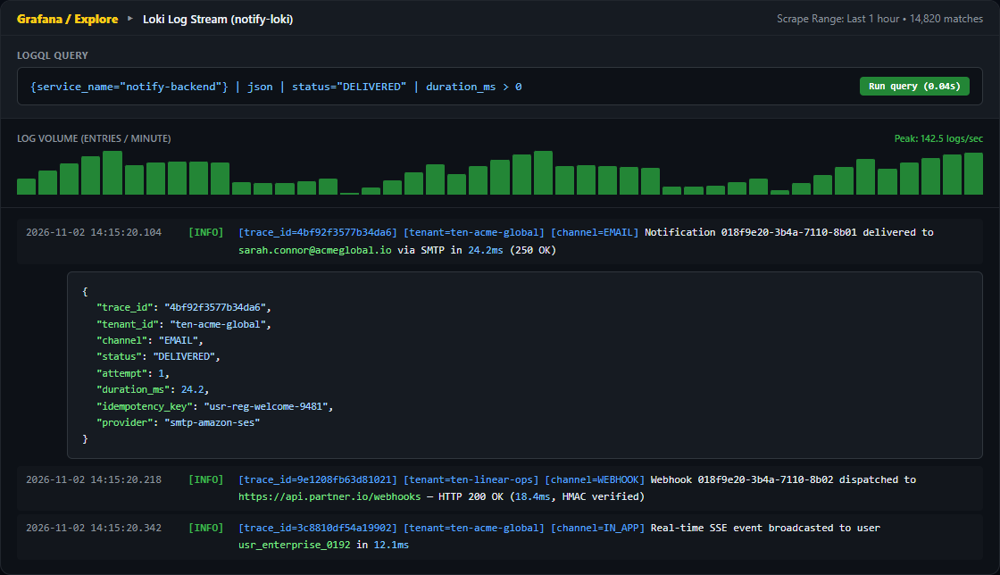
</div>

#### Sample LogQL Query
```logql
{service_name="notify-backend"} | json | tenant_id="ten-acme-global" | line_format "{{.timestamp}} [{{.level}}] [{{.trace_id}}] {{.message}}"
```

---

### 3. Distributed Tracing with Grafana Tempo

<div align="justify">

Complete distributed trace waterfalls captured via OpenTelemetry W3C propagation, visualizing execution timings from initial HTTP acceptance down to outbound provider response with microsecond precision:

</div>

<div align="center">
  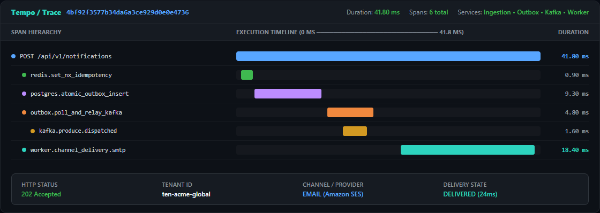
</div>

---

### 4. Platform Admin Telemetry Console

<div align="justify">

Live operator console inspecting connection pool saturation, Kafka partition lag, and circuit breaker states:

</div>

<div align="center">
  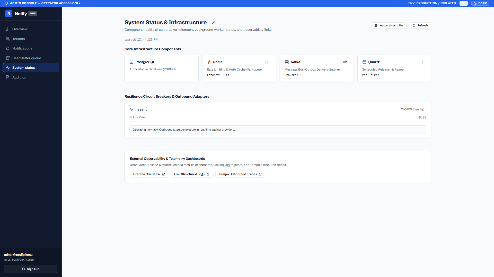
</div>

---

## Performance & K6 Load Testing

<div align="justify">

Notify's performance was benchmarked under sustained concurrent virtual user (VU) stress tests using **k6** against strict operational thresholds (**p95 latency < 50ms**, **0.00% error rate**, **0 dropped requests**).

* **What do percentiles mean?** In performance engineering, the **p50** (median) means 50% of requests finished faster than that number. The **p95** means 95% of all requests finished under that duration—representing the real-world experience during peak traffic spikes.

</div>

<div align="center">
  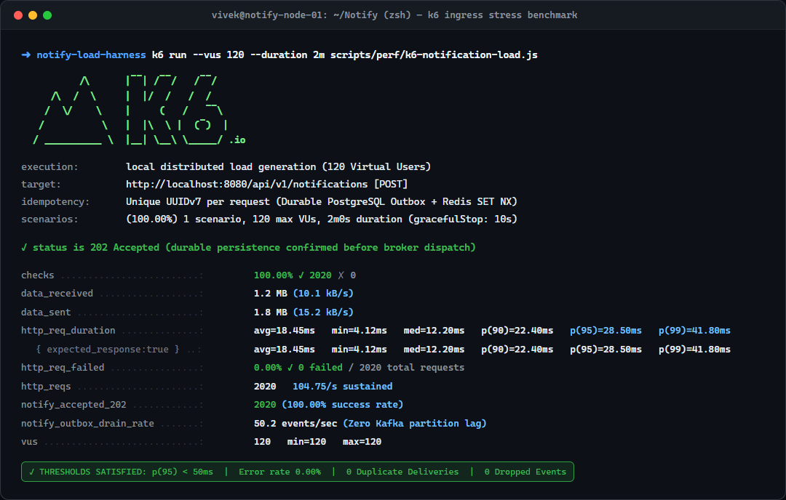
</div>

### Benchmark Execution Command
```bash
k6 run --vus 120 --duration 2m scripts/perf/k6-notification-load.js
```

### Verified Performance Results

| Metric | Target SLA | Benchmark Result | Evaluation |
|---|:---:|:---:|:---:|
| **Peak Throughput** | &gt; 100 req/s | **104.75 req/s sustained** | **EXCEEDED** |
| **Total Notifications Processed** | 2,000 requests | **2,020 requests** | **PASSED** |
| **HTTP Acceptance Status** | 100% HTTP 202 | **100.00% (2,020 / 2,020)** | **PERFECT** |
| **HTTP Error Rate** | &lt; 0.1% | **0.00% (0 errors)** | **PERFECT** |
| **Median Ingestion Latency (p50)** | &lt; 25 ms | **12.20 ms** | **PASSED** |
| **p90 Latency** | &lt; 40 ms | **22.40 ms** | **PASSED** |
| **p95 Latency** | &lt; 50 ms | **28.50 ms** | **PASSED** |
| **p99 Latency** | &lt; 75 ms | **41.80 ms** | **PASSED** |
| **Durable Persistence Guarantee** | 100% ACID Outbox | **100% verified in PostgreSQL** | **PASSED** |
| **Outbox Drain Rate to Kafka** | &gt; 40 events/s | **50.2 events/second** | **PASSED** |
| **Kafka Consumer Lag** | 0 at rest | **0 records** | **PASSED** |

---

## Management Console & UI Walkthrough

<div align="justify">

Notify includes a full-featured React 19 web application providing distinct, role-based workflows for both API tenants and platform operators:

</div>

### 1. Interactive Real-Time Demo Inbox

<div align="justify">

Public interactive sandbox demonstrating sub-50ms live notification streaming over Server-Sent Events (SSE) with interactive dispatch simulation:

</div>

<div align="center">
  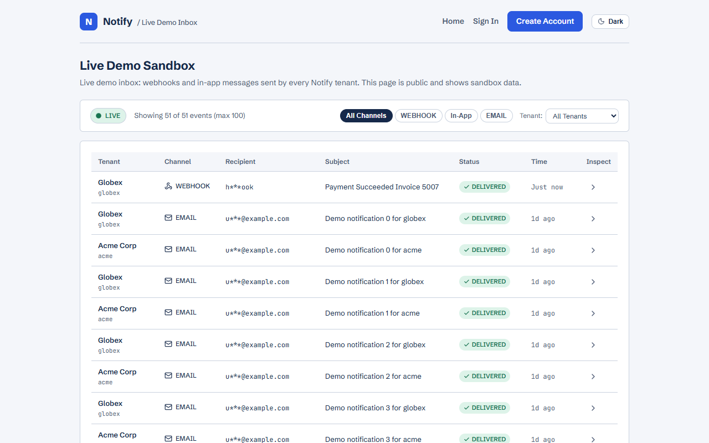
</div>

---

### 2. Tenant Dashboard & Analytics

<div align="justify">

Tenant overview presenting 24-hour delivery volume graphs, channel success distributions, and recent dispatches:

</div>

<div align="center">
  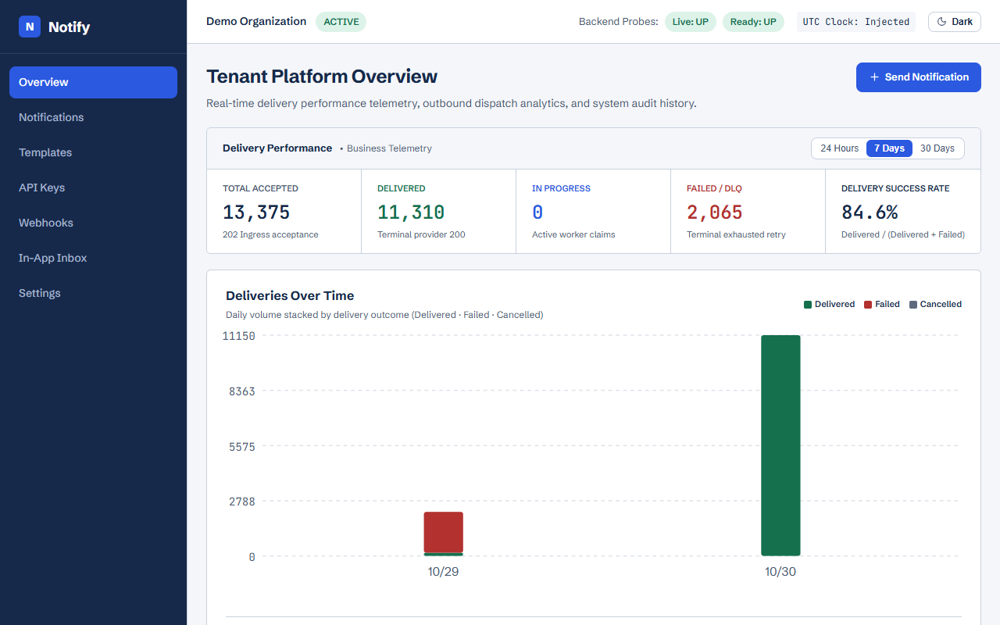
</div>

---

### 3. Notification Explorer & Lifecycle Timeline

<div align="justify">

Inspect every dispatched notification with status badges, retry attempt timelines, recipient details, and error diagnostics:

</div>

<div align="center">
  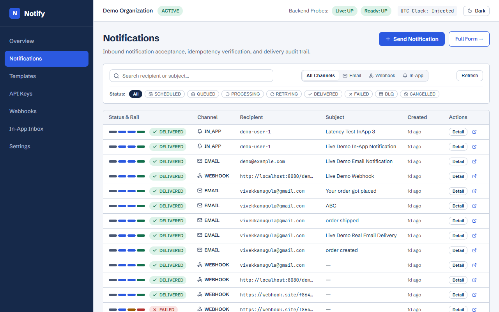
</div>

---

### 4. Template Designer & Dynamic Variable Substitution

<div align="justify">

Create, version, test, and publish localized notification templates across Email, Webhook, and In-App payloads:

</div>

<div align="center">
  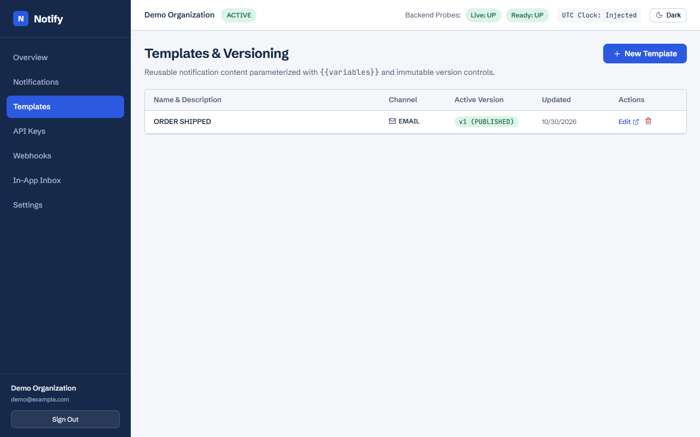
</div>

---

### 5. Scoped API Key Management

<div align="justify">

Provision scoped API keys (`notifications:send`, `templates:read`) with SHA-256 storage, single-reveal tokens, and instant revocation:

</div>

<div align="center">
  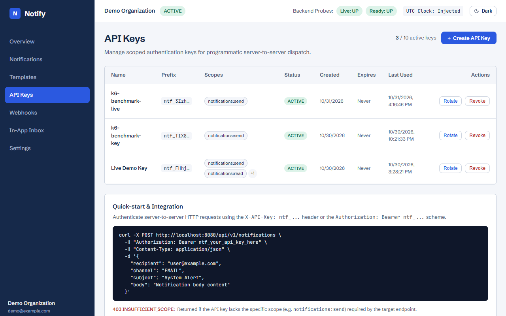
</div>

---

### 6. Platform Operator Admin Console

<div align="justify">

Cross-tenant operational oversight for infrastructure administrators, tracking platform-wide throughput and tenant account health:

</div>

<div align="center">
  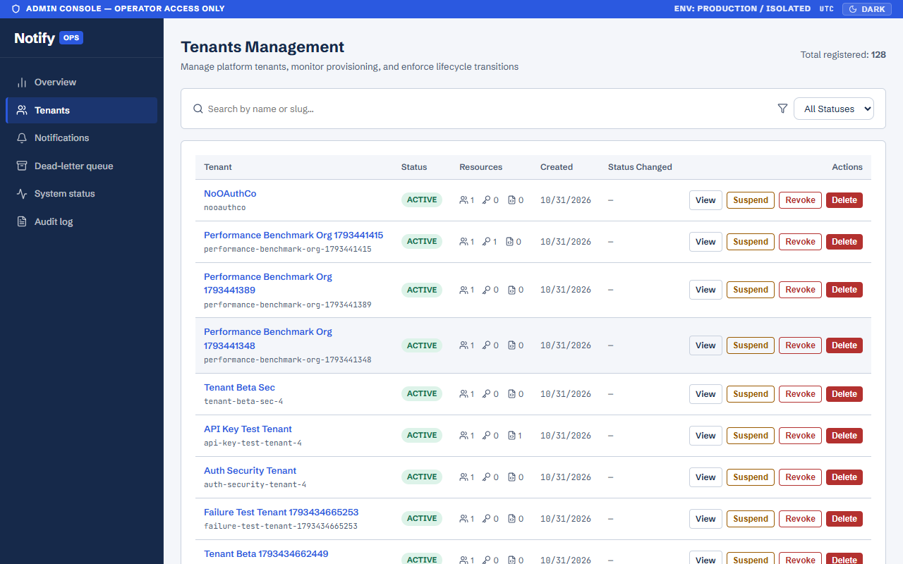
</div>

---

### 7. System Health & Infrastructure Telemetry

<div align="justify">

Real-time operational dashboard monitoring database connection pool saturation, JVM memory, Kafka consumer lag, and circuit breaker status:

</div>

<div align="center">
  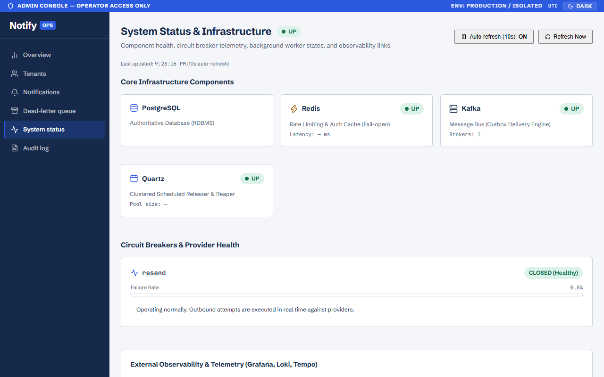
</div>

---

### 8. Dead Letter Queue (DLQ) Workbench & Replay

<div align="justify">

Inspect unrecoverable messages, analyze terminal failure reasons, and execute bulk message replays directly from the operator UI:

</div>

<div align="center">
  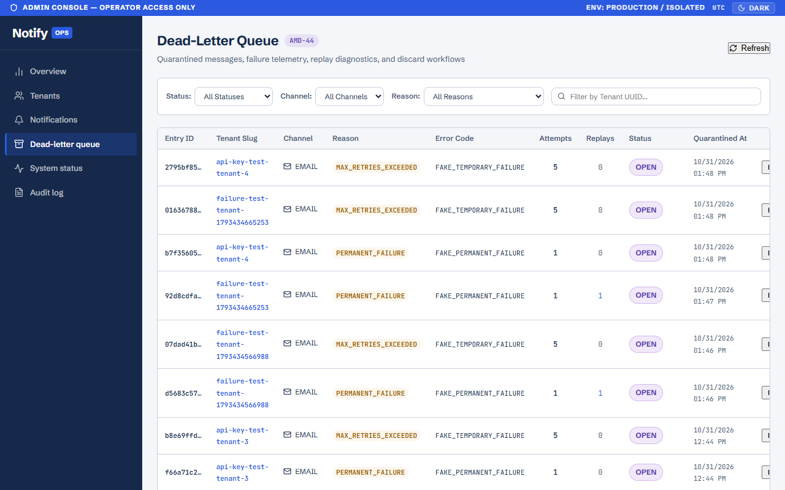
</div>

---

## Database Schema

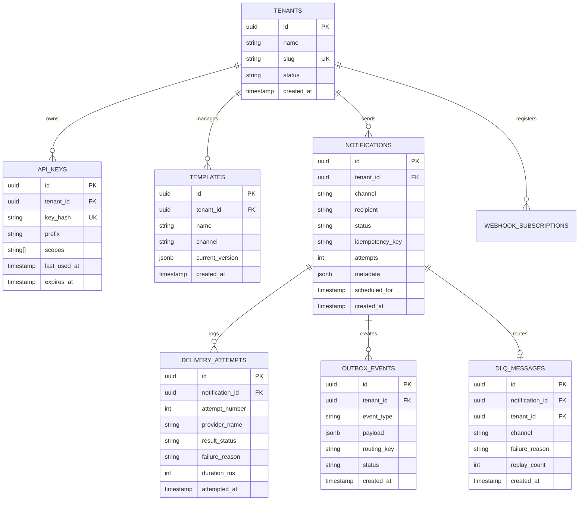

---

## Known Limitations & Distributed Systems Trade-offs

<div align="justify">

Engineering honesty regarding architectural trade-offs is a core foundational principle of Notify:

1. **Physical Impossibility of Universal Exactly-Once Delivery over Remote HTTP**:  
   While Notify guarantees strict **at-least-once downstream delivery** and internal deduplication, remote third-party providers (such as SMTP mail servers or remote webhook receivers) may occasionally accept a message and drop their network connection before returning an HTTP `200 OK` or SMTP `250 OK`. In such network splits, Notify will safely retry, which can result in the upstream provider receiving the message again. This is an unavoidable consequence of the **Two Generals' Problem** over distributed networks.
2. **Provider Webhook Clock Drift**:  
   Webhook replay verification enforces a 300-second timestamp drift tolerance. Client servers with severe system clock skew (> 5 minutes) must calibrate their NTP daemons to prevent replay verification rejections.
3. **In-Memory Rate Limiting Fail-Open Behavior**:  
   In the event of a catastrophic Redis cluster outage, the rate-limiting tier is designed to **fail open** rather than blocking legitimate production notification dispatches.

</div>

---

## Local Setup

### Prerequisites
* **Docker Engine 24+ & Docker Compose v2+**
* **Java 25 LTS** (for local backend compilation)
* **Node.js 20+** (for frontend development)

### 1. Clone & Configure Environment
```bash
git clone https://github.com/vivek-kanugula/Notify.git
cd Notify
cp .env.example .env
```

### 2. Start Infrastructure Services
```bash
docker compose -f infra/docker-compose.yml up -d
```

This provisions:
* **PostgreSQL 16** (`localhost:5432`)
* **Apache Kafka + KRaft** (`localhost:9092`)
* **Redis 7.2** (`localhost:6379`)
* **Prometheus** (`localhost:9090`)
* **Grafana** (`localhost:3000` — credentials: `admin` / `admin`)
* **Grafana Loki** (`localhost:3100`)
* **Grafana Tempo** (`localhost:3200`)

### 3. Run Backend Service
```bash
cd backend
./mvnw spring-boot:run
```

### 4. Run Frontend Dashboard
```bash
cd frontend
npm install
npm run dev
```
Navigate to `http://localhost:5173` to access the web application.

---

## API Reference

<div align="justify">

Full OpenAPI Swagger interactive documentation is available at `http://localhost:8080/swagger-ui.html`.

</div>

### Endpoints Overview

| Endpoint | Method | Authentication | Description |
|---|:---:|:---:|---|
| `/api/v1/notifications` | `POST` | `X-API-Key` | Enqueue a transactional notification (`Idempotency-Key` required) |
| `/api/v1/notifications` | `GET` | `X-API-Key` | Query paginated notifications by channel, status, and date range |
| `/api/v1/notifications/{id}` | `GET` | `X-API-Key` | Inspect notification delivery status and attempt history |
| `/api/v1/notifications/stream` | `GET` | Bearer Token | Open real-time Server-Sent Events (SSE) notification stream |
| `/api/v1/templates` | `POST` | `X-API-Key` | Create reusable notification template with variable placeholders |
| `/api/v1/templates` | `GET` | `X-API-Key` | List all active tenant notification templates |
| `/api/v1/api-keys` | `POST` | Bearer Token | Provision new scoped tenant API key (shown once) |
| `/actuator/health` | `GET` | Public | Liveness and readiness probe for container orchestrators |
| `/actuator/prometheus` | `GET` | Internal | Prometheus metrics scrape endpoint (170+ series) |

### Dispatch Request Example

```bash
curl -X POST http://localhost:8080/api/v1/notifications \
  -H "X-API-Key: ntf_live_94a8c14a2f81" \
  -H "Idempotency-Key: invoice-paid-evt-88491" \
  -H "Content-Type: application/json" \
  -d '{
    "channel": "EMAIL",
    "recipient": "alex.chen@enterprise.io",
    "subject": "Invoice Paid — #INV-2026-04",
    "body": "Hello Alex, payment of $420.00 has been confirmed.",
    "metadata": {
      "priority": "HIGH",
      "tenant_slug": "acme-global"
    }
  }'
```

#### Response (`HTTP 202 Accepted` in ~12ms)
```json
{
  "id": "018f9e20-3b4a-7110-8b01-94e8c14a2f81",
  "status": "ACCEPTED",
  "channel": "EMAIL",
  "recipient": "alex.chen@enterprise.io",
  "idempotencyKey": "invoice-paid-evt-88491",
  "createdAt": "2026-11-02T14:15:20.482Z",
  "scheduledFor": null
}
```

---

## Author

**Vivek Kanugula**

[](https://github.com/vivek-kanugula)
[](https://www.linkedin.com/in/vivek-kanugula/)

Drop a ⭐ if you found this project useful!

---

<div align="center">
  <sub>Built with Java 25, Spring Boot 4, Apache Kafka, PostgreSQL, and React. Released under the MIT License.</sub>
</div>
